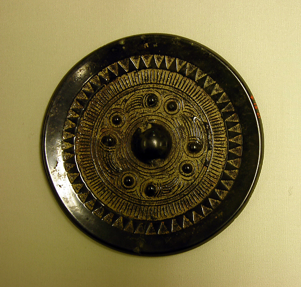
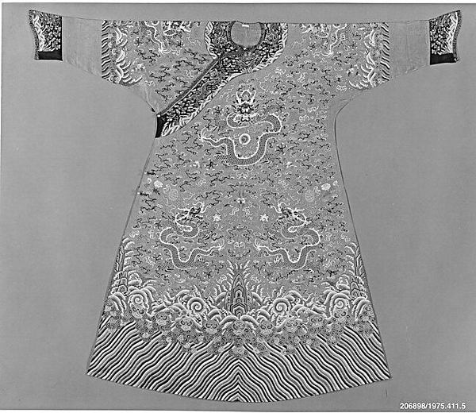
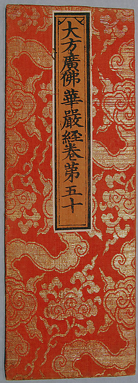
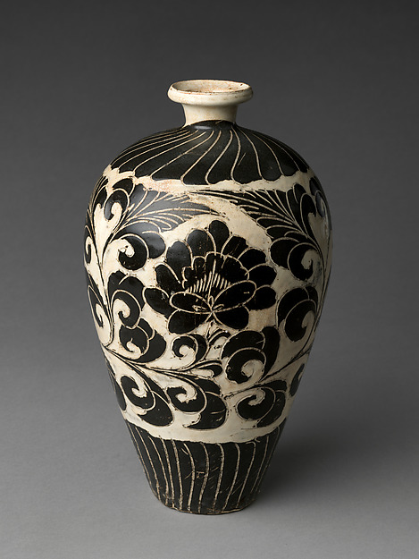
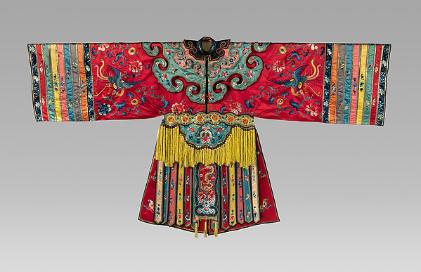
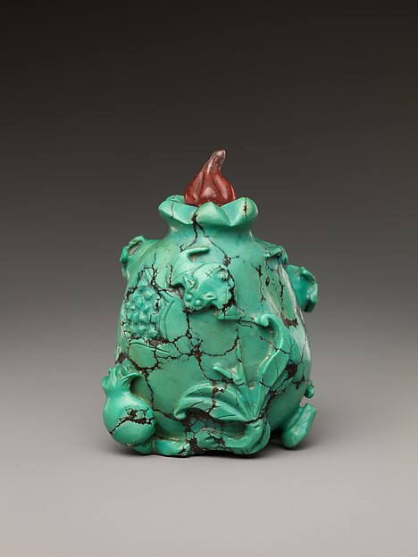
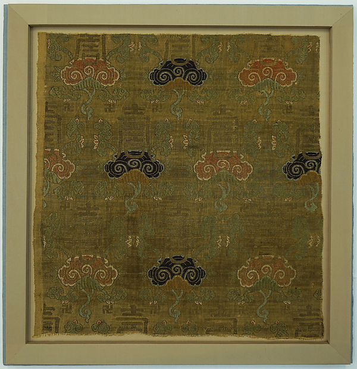
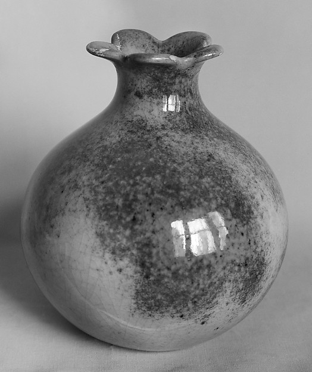

## 一、日用而不察的文明载体

纹样（pattern / motif）是附加于器物、服饰、建筑表面的装饰图形。它既可以只是几条折线、几片花瓣，也可以是一整套关于秩序、信仰与幸福的表达。吴文化博物馆馆长陈曾路在谈“纹章九州——中国古代的纹饰和纹样”展时，对纹样的位置作过这样的说明：

> 「中华文明绵延千载，其博大精深不仅蕴藏于经史子集、典章制度，更生动镌刻在纹饰纹样中。对于纹饰纹样，人们往往是日用而不察，但它又绵长而张力十足，从古至今一脉相承，与当下息息相关。」[1](https://www.chinanews.com.cn/m/dxw/2026/02-21/10574936.shtml)

在同一篇报道中，记者对传统纹样的类别作了概括：

> 「中国传统纹样大致可分为几何纹、动物纹、植物纹、人物纹、器物纹等类别。」[2](http://js.people.com.cn/n2/2026/0428/c360303-41565094.html)

这一分类只是方便叙述的框架。实际器物上，几何、动物、植物往往相互穿插：云雷纹可以衬托兽面，缠枝可以承载莲花，龙纹之间又填以云蝠与杂宝。分类帮助我们辨认母题，而纹样的意义常常产生于组合之中。

陈曾路还指出，中国纹样史的一条重要线索是不断吸收外来因素：

> 「中国纹饰纹样最大的特点就是它不断地在吸收、融合、包容外来纹饰纹样，然后按照中国人的审美中国化。」[1](https://www.chinanews.com.cn/m/dxw/2026/02-21/10574936.shtml)

*图1　西汉铜镜（bronze mirror），公元前2—前1世纪，青铜。镜背以乳钉和回旋线条组织出严整的几何纹样，是早期中国装饰几何化倾向的实例。大都会艺术博物馆藏，Rogers Fund, 1917。图片来源：[The Met](https://www.metmuseum.org/art/collection/search/61382)（公共领域，CC0）。*

---

## 二、“图必有意，意必吉祥”：纹样的表意系统

### 2.1 “吉祥”的词源

“吉祥”二字很早就与“福善”“嘉庆”联系在一起。《庄子·人间世》有“虚室生白，吉祥止止”之语，唐代成玄英疏曰：

> 「吉者，福善之事；祥者，嘉庆之征。」3

这句话把“吉”解释为得福行善之事，把“祥”解释为喜庆的征兆。后世把动植物、器物、文字组织成图案，以寄托福、禄、寿、喜、财等愿望，正是沿着这种“以物征事”的思路展开的。

### 2.2 明清以来的吉祥图案

研究民间美术的潘鲁生、刘燕把这一传统概括为一种自觉的创作理念：

> 「中国民间美术中蕴藏着记录民生、反映思想与情感、承载‘图必有意，意必吉祥’理念的人文之美。」[4](http://paper.people.com.cn/rmrbhwb/pc/content/202609/11/content_30180501.html)

这句话可意译为：*Every image carries meaning, and every meaning is auspicious.*

故宫博物院对“吉祥图案”（auspicious patterns）的释义，则把常见的对应关系列举得十分清楚：

> 「中国传统装饰图案，用以表示祝福和象征吉祥。明清以来，以寓意、谐音的方式体现吉祥的图案十分流行。如牡丹——富贵，桃实——祝寿，石榴——多子，蝙蝠——福，喜鹊——喜庆，鱼——富足有余等等。」[5](https://www.dpm.org.cn/lemmas/241317.html)

同一条目还列举了多种动植物搭配而成的固定组合：

> 「梅花、竹子、喜鹊——‘梅竹双喜’；牡丹、白头翁——‘富贵白头’；蜜蜂、马、猴——‘马上封侯’；牡丹、瓶——‘富贵平安’；鹿、鹤——‘鹤鹿同春’；灵芝、仙鹤衔佛手、竹——‘灵仙祝寿’；石榴、佛手、桃实——‘福寿三多’；卍带、鲇鱼、如意——‘万年如意’、‘年年有余’；荷花与盒——‘和合二喜’；如意云纹、平水杂宝、海水江崖——‘寿山福海’等等。」[5](https://www.dpm.org.cn/lemmas/241317.html)

这些组合使用了三种基本手法：**谐音**（homophony；蝠—福、瓶—平、鲇—年）、**象征**（symbolism；石榴多子、桃实长寿、牡丹富贵）与**文字直陈**（direct use of characters；寿、福、卍）。故宫所藏清乾隆“香色缎绣云金龙纹袷袍”的一则说明，几乎把三种手法用在了同一件衣服上：

> 「龙纹间饰以五色云蝠、杂宝和多种吉祥花卉，以玉兰、海棠、牡丹花寓意‘玉堂富贵’，灵芝、竹和水仙寓意‘灵仙祝寿’，石榴、佛手、桃实寓意‘福寿三多’，松、竹、梅寓意‘岁寒三友’，柿子与如意寓意‘事事如意’。下摆绣平水江崖纹，中有戟磬、灵芝、珊瑚、海珠和蝙蝠，寓意‘寿山福海’。」[6](https://www.dpm.org.cn/collection/embroider/228698.html)

*图2　清代龙袍（dragon robe），18世纪，丝绸。龙纹、云纹与下摆的水波山崖共同构成典型的帝王服饰纹样系统。大都会艺术博物馆藏，Gift of Mr. Stanley Marcus, Neiman-Marcus and Baron W. Langer von Langerdorff, Evyan Perfumes, Inc., 1975。图片来源：[The Met](https://www.metmuseum.org/art/collection/search/70591)（公共领域，CC0）。*

---

## 三、历史脉络：从陶器刻划到织绣满身

### 3.1 新石器时代：纹样的起点

《人民日报海外版》关于“纹章九州”展的报道，把史前纹样的意义说得颇为清楚：

> 「新石器时代，先民已经开始运用多种纹样装饰技法，如刻划、拍印、彩绘等。饰于器物上的原始纹样，承载着先民对自然的理解、对生命的表达、对秩序的想象和对宇宙的思考，经历了由具象写实到抽象凝练的艺术演进。」[2](http://js.people.com.cn/n2/2026/0428/c360303-41565094.html)

同文举西安半坡博物馆藏人面鱼纹尖底器为例，指出这类纹样「可能反映了先民的信仰」；又指出史前陶器上「弦纹、网格纹、水波纹等」几何纹样「通过点、线、面的组合，可以表达丰富的意涵」[2](http://js.people.com.cn/n2/2026/0428/c360303-41565094.html)。可见中国纹样从一开始就同时承担装饰与表意两种功能。

### 3.2 商周：青铜器上的秩序

商周青铜器（bronzes）是中国纹样史上第一个高峰。云雷纹、兽面纹、夔龙纹、凤鸟纹以严整的对称和细密的线条组织起来，构成中国青铜装饰的典型面貌。展览报道写道：

> 「商周时期，云雷纹大量应用于青铜器，多作地纹以烘托主体纹饰。」[2](http://js.people.com.cn/n2/2026/0428/c360303-41565094.html)

> 「到了商周时期，兽面纹成为青铜器上的核心纹饰，顶有双角、两眼凸出、左右对称是其显著特征。」[2](http://js.people.com.cn/n2/2026/0428/c360303-41565094.html)

兽面纹（又称饕餮纹，animal-mask / taotie motif）的衰落也被概括为一条清晰的社会史线索：

> 「兽面纹在商周时期发展到顶峰，春秋战国以降，随着青铜器衰落，兽面纹逐渐从器物的主体纹饰中淡出，其形象逐渐简化、世俗化，主要用于瓦当、铺首、墓葬石刻中，兼具装饰与辟邪功能。」[2](http://js.people.com.cn/n2/2026/0428/c360303-41565094.html)

### 3.3 秦汉魏晋：云气、神仙与佛教东来

汉代纹样最具时代气息的是云气纹。展览中的汉代“长葆子孙”云气动物纹经锦，被描述为：

> 「以穗状云气纹为骨架，其间穿插动物纹，夹织‘长葆子孙’等隶书吉祥文字，表达了当时人们渴望得道飞升、福荫子孙的理念。」[2](http://js.people.com.cn/n2/2026/0428/c360303-41565094.html)

报道同时指出：

> 「云气纹是汉魏时期流行的纹饰，由早期的云纹演变而来，表现天界与飞升意象。」[2](http://js.people.com.cn/n2/2026/0428/c360303-41565094.html)

魏晋南北朝是植物纹样大规模进入中国装饰体系的转折点。中国工艺美术学会的文章写道：

> 「从魏晋南北朝开始，在佛教装饰艺术的影响下，植物花卉题材的纹饰渗透到了包括陶瓷装饰、建筑装饰和金属器皿装饰等几乎所有的艺术领域。」[14](https://m.cnacs.net.cn/19/202204/3893.html)

佛教的传入使莲花、忍冬等纹样获得新的宗教含义，并逐渐与中国本土的云纹、龙凤纹结合。

### 3.4 隋唐：宝相花与缠枝的盛世

隋唐时期，植物花卉纹样取代动物纹样成为装饰主体。宝相花（baoxiang flower / composite floral medallion）、缠枝纹（scrolling-vine pattern）、卷草纹（scroll pattern）在丝织、金银器、铜镜、瓷器上广泛流行。故宫博物院对“宝相花”的释义是：

> 「我国传统装饰纹样之一，又称‘宝仙花’、‘宝莲花’。一般以某种花卉（如牡丹、莲花）为主体，中间镶嵌形状不同、大小粗细有别的其它花叶，尤其在花芯和花瓣基部，用圆珠作规则排列，似闪闪发光的宝珠，富丽华美，故名宝相花。盛行于隋唐时期，元明清时期的器物上亦多以之为装饰题材。」[7](https://www.dpm.org.cn/lemmas/242132.html)

### 3.5 宋元：写实、清雅与“满池娇”

宋代工艺美术转向清丽淡雅，纹样也趋于写实、含蓄。以莲花为例：

> 「与唐代富丽的宝相花纹不同，宋代花鸟纹样追求自然写意，莲花纹常用于体现文人雅士对莲花高洁品格的追慕。」[2](http://js.people.com.cn/n2/2026/0428/c360303-41565094.html)

元代最值得注意的新题材之一，是由莲、叶、水鸟组成的“满池娇”：

> 「元代，由莲花、莲叶、水鸟等元素构成的‘满池娇’图案盛行，在瓷器、织绣品、金银器上均有呈现。」[2](http://js.people.com.cn/n2/2026/0428/c360303-41565094.html)

### 3.6 明清：吉祥图案的集成时代

明清是吉祥图案的集成期。举凡福、禄、寿、喜、财，几乎都能找到对应的动植物、器物与文字组合。回纹的命运颇具代表性：

> 「到了明清，回纹已走进百姓日常生活，广泛运用于瓷器、织绣、木雕、漆器以及建筑装饰中。这一时期，民间赋予了连续回纹‘富贵绵延’‘吉利永昌’等象征内涵，至此，回纹基本完成了向世俗吉祥符号的转化。」[8](http://paper.people.com.cn/rmrbhwb/pc/content/202609/11/content_30180502.html)

| 时期 | 代表纹样 | 主要载体 | 资料中的概括 |
|---|---|---|---|
| 新石器时代 | 水波纹、网格纹、人面鱼纹、回旋几何 | 陶器 | 「由具象写实到抽象凝练的艺术演进」[2](http://js.people.com.cn/n2/2026/0428/c360303-41565094.html) |
| 商周 | 云雷纹、兽面纹、夔龙纹、凤鸟纹 | 青铜礼器 | 「多作地纹以烘托主体纹饰」[2](http://js.people.com.cn/n2/2026/0428/c360303-41565094.html) |
| 秦汉魏晋 | 云气纹、四灵、莲花、忍冬 | 织锦、漆器、铜镜、石窟 | 「表现天界与飞升意象」[2](http://js.people.com.cn/n2/2026/0428/c360303-41565094.html) |
| 隋唐 | 宝相花、缠枝纹、卷草纹、团花 | 丝织、金银器、铜镜、瓷器 | 「盛行于隋唐时期」[7](https://www.dpm.org.cn/lemmas/242132.html) |
| 宋元 | 折枝花、莲花、满池娇、回纹 | 瓷器、织绣、金银器 | 「追求自然写意」[2](http://js.people.com.cn/n2/2026/0428/c360303-41565094.html) |
| 明清 | 吉祥图案、回纹、云蝠、海水江崖 | 织绣、瓷器、家具、建筑 | 「图必有意，意必吉祥」[4](http://paper.people.com.cn/rmrbhwb/pc/content/202609/11/content_30180501.html) |

---

## 四、代表纹样个案

### 4.1 云雷纹与云纹

云雷纹（cloud-and-thunder pattern）是商周青铜器上最常见的底纹，也是理解中国“云”纹家族的起点。故宫的释义极为简洁：

> 「青铜器上的典型纹饰。是以连续的回旋形线条构成几何图纹，圆形为云纹，方形为雷纹。在后代的其他工艺品装饰中也有使用。」[9](https://www.dpm.org.cn/lemmas/241368.html)

《人民日报海外版》在梳理回纹源流时，引用了工艺美术史论家田自秉《中国纹样史》中的辨析：

> 「云雷纹由云纹和雷纹组成，古代的云和雷是有区别的，即圆形为云纹，方形为雷纹；云为云气之行，雷为回转之声，均作旋转状。」[8](http://paper.people.com.cn/rmrbhwb/pc/content/202609/11/content_30180502.html)

同文进一步指出：「其中方折雷纹与后世回纹关系较为密切，圆转云纹则更接近于卷云、云气纹的结构来源。」[8](http://paper.people.com.cn/rmrbhwb/pc/content/202609/11/content_30180502.html) 这就把几何形的云雷纹与后来流动的云气纹、卷云纹接上了谱系。

宋以后，云纹逐渐定型为“如意云”（ruyi cloud）。故宫“如意式云头纹”条说：

> 「简称如意云纹，状似灵芝头部，故又称灵芝云。古代灵芝被视为仙草，是吉祥长寿的象征，因而人们制作的如意头部多采用灵芝头的形式。明清之际，图案上表现的朵云亦多为变形灵芝式，这种变形的云纹被称作如意云纹或灵芝云纹。」[10](https://www.dpm.org.cn/lemmas/244511.html)

*图3　明代经皮（sutra cover），16世纪，丝与金属线。图案以灵芝与斜向云带组成，可作为“灵芝云/如意云”系统的实物例证。大都会艺术博物馆藏，Purchase, Friends of Asian Art Gifts, in honor of James C. Y. Watt, 2011。图片来源：[The Met](https://www.metmuseum.org/art/collection/search/76616)（公共领域，CC0）。*

### 4.2 回纹

回纹（meander / key-fret pattern）因形似汉字“回”而得名，是中国延续时间最长的几何纹之一。故宫的释义是：

> 「家具上常用的纹饰之一，由陶器和青铜器上的雷纹衍化而来，寓意吉利深长，苏州民间称之为‘富贵不断头’。在家具上，回纹主要作为边饰，用于边框、牙条、足端或束腰等处。家具上大量采用回纹见于清代。」[11](https://www.dpm.org.cn/lemmas/245233.html)

《人民日报海外版》专文对回纹的源流作了系统梳理：

> 「回纹，亦称回形纹、回字纹，是以横竖短线折绕组成、因形如汉字‘回’而得名的一种传统几何装饰纹样，是中国历史最悠久、造型最简洁的纹饰之一。因其回环反复、绵延不绝的构成形式，回纹被民间赋予‘富贵绵延’的吉祥寓意。」[8](http://paper.people.com.cn/rmrbhwb/pc/content/202609/11/content_30180502.html)

关于起源，该文持谨慎态度：

> 「从迄今考古发现看，回纹的雏形可追溯至新石器时代晚期，在马家窑文化的陶器上已可见若干方折回旋的几何元素。这一时期的回纹尚处于几何抽象的萌芽阶段。」[8](http://paper.people.com.cn/rmrbhwb/pc/content/202609/11/content_30180502.html)

文章还从形式美的角度解释回纹为何耐看：

> 「回纹的美学精髓集中体现于‘方、圆、连、续’的秩序感与延续性上。它由简单的线条组成，以简洁规整的秩序感为基础，通过连续的回旋产生动态的韵律，整体看来就具有了流动感与规整美。」[8](http://paper.people.com.cn/rmrbhwb/pc/content/202609/11/content_30180502.html)

### 4.3 缠枝纹

缠枝纹是以藤蔓为骨架、花朵为节点的连续纹样，南北朝至唐代逐渐成熟，宋元以后成为瓷器、织绣上最常见的装饰之一。故宫的释义是：

> 「中国传统装饰花纹之一。所绘花朵系以植物的枝干或蔓藤作骨架，枝叶相互缠绕，构成四方连续或二方连续的图案，统一中寓变化。有缠枝莲、缠枝菊、缠枝牡丹和缠枝宝相花等多种纹样。」[12](https://www.dpm.org.cn/lemmas/239382.html)

滁州市博物馆的一篇科普文章对缠枝纹的别名、原型与寓意作了通俗说明：

> 「缠枝纹，俗称‘缠枝花’，又名‘万寿藤’，它与莲花纹、卷云纹、如意纹、回纹等一样，都是中国古代艺术品的重要装饰纹样之一。」[13](http://ahczww.com/news/xwdt/2020-04-01/8256.html)

> 「这些植物均属吉祥花草，多为世人所赞咏……寓意生生不息、万代绵长的美好愿望。」[13](http://ahczww.com/news/xwdt/2020-04-01/8256.html)

关于缠枝纹的起源，学界并无定论。该文把几种代表性观点并列：

> 「西方学者阿洛瓦·里格尔在其著作《风格问题》中指出缠枝纹源于希腊人的创造，它以莲花和纸莎草为原型在克里特地区发展成为连续的波浪形纹样。而我国学者田自秉先生在其所著的《中国纹样史》中认为缠枝纹起源于我国汉代的卷云纹：‘汉代称之为卷云纹，魏晋南北朝称之为忍冬纹，唐代称之为卷草纹，近代配以花朵称之为缠枝纹。’」[13](http://ahczww.com/news/xwdt/2020-04-01/8256.html)

> 「另外吴山先生在《中国工艺美术大辞典》中也认为：‘缠枝纹约起源于汉代，盛行于南北朝、隋唐、宋元明清。’」[13](http://ahczww.com/news/xwdt/2020-04-01/8256.html)

作者本人则给出一个折中的判断：

> 「笔者认为缠枝纹是中国化的西式纹样，并不单纯的来自西方或东方，而是在吸收外来纹样的基础上对本土纹样进行的多元综合。」[13](http://ahczww.com/news/xwdt/2020-04-01/8256.html)

文章还点出了缠枝纹与青花瓷的特殊关系：

> 「元代青花瓷的出现为缠枝纹提供了绝妙的展示载体，并一直延续下去，成为青花瓷最重要的装饰纹样。」[13](http://ahczww.com/news/xwdt/2020-04-01/8256.html)

*图4　北宋磁州窑（Cizhou ware）白地黑花缠枝牡丹纹瓶，11—12世纪。器身以连续的波状枝蔓串起大朵牡丹，是缠枝纹在陶瓷上的典型表现。大都会艺术博物馆藏，Rogers Fund, 1925。图片来源：[The Met](https://www.metmuseum.org/art/collection/search/42474)（公共领域，CC0）。*

### 4.4 宝相花

宝相花不是自然界中真实存在的花，而是莲花、牡丹、菊花等花形经过理想化组合后的“宝花”。中国工艺美术学会的一篇文章解释：

> 「所谓宝相是佛教徒对佛像的尊称，宝相花则是圣洁、端庄、美观的理想花形。此纹饰是魏晋南北朝以来伴随佛教盛行的流行图案，它集中了莲花、牡丹、菊花的特征，是经过艺术处理而组合的图案。」[14](https://m.cnacs.net.cn/19/202204/3893.html)

同文亦指出其形式来源与外来工艺有关：

> 「这种处理变形的手法，是和魏、晋、南北朝以来以金银珠宝镶嵌的细金工艺的启发分不开的。」[14](https://m.cnacs.net.cn/19/202204/3893.html)

故宫的释义则强调其“宝珠”式的装饰特征，见前引[7](https://www.dpm.org.cn/lemmas/242132.html)。宝相花在隋唐达到鼎盛，此后长期作为瓷器、织锦、铜镜上的高级装饰母题。

### 4.5 莲花纹

莲花纹（lotus pattern）是中国植物纹样中来源最复杂、延续最久的一种。展览报道写道：

> 「莲花纹最早可追溯到新石器时代，浙江余姚河姆渡遗址出土的文物中有线刻纹类似莲瓣。」[2](http://js.people.com.cn/n2/2026/0428/c360303-41565094.html)

> 「汉代佛教传入后，莲花作为佛教吉祥图案，与中国本土文化结合，呈现出折枝、团花等不同的形态，并与忍冬纹等组合，广泛应用于各种艺术装饰中。」[2](http://js.people.com.cn/n2/2026/0428/c360303-41565094.html)

这段叙述提示我们：同一朵莲花，在佛教语境中是清净、圣洁的象征，在世俗语境中又可以谐音“连”：与鱼组成“年年有余”[5](https://www.dpm.org.cn/lemmas/241317.html)，与童子组成“连生贵子”[2](http://js.people.com.cn/n2/2026/0428/c360303-41565094.html)。纹样的意义随语境滑动，正是中国装饰传统的一大特点。

### 4.6 龙纹、凤纹与海水江崖

龙纹（dragon motif）是中国最具连续性的纹样母题之一。陈曾路在访谈中说：

> 「中国纹饰纹样又有很强的在地性与向心力，其中一些核心主题甚至能够跨越时代与地域。譬如龙，尽管在不同时期不同区域有着各种样貌，但龙的形象贯穿中华文明发展的始终。类似的情形在欧美文化中是很难找到的。」[1](https://www.chinanews.com.cn/m/dxw/2026/02-21/10574936.shtml)

在帝王服饰上，龙纹与云纹、海水江崖（seawater-and-cliff pattern）组合，形成一整套宇宙论式的构图。前引乾隆龙袍的说明已经展示了这种组合的丰富性[6](https://www.dpm.org.cn/collection/embroider/228698.html)。故宫“八宝立水”条对袍褂下摆的纹样有专门解释：

> 「中国古代服饰纹样。由八宝纹及立水纹组合而成，多织绣于袍褂的下摆。这里的八宝亦称杂宝，常见者有珊瑚珠、珊瑚枝、方胜、犀角、杯、古钱、火珠、如意、书、画、蕉叶、灵芝、元宝、磬等，可随意选取数件组成图案。立水由许多并列的弯曲线条，即水脚和水脚之上波涛翻滚的水浪组成。八宝置于水浪之上，除了表示绵延不断的吉祥含义外，还有‘一统山河’和‘万世升平’之寓意。」[15](https://www.dpm.org.cn/lemmas/241324.html)

凤纹（phoenix motif）常与龙纹对举，用于宫廷服饰与婚嫁用品，形成“龙凤呈祥”的固定搭配。

*图5　清代戏衣（theatrical robe），19世纪，丝线绣于缎地。通身以凤鸟与折枝花卉为主题，可见凤纹在戏曲服饰中的运用。大都会艺术博物馆藏，Rogers Fund, 1930。图片来源：[The Met](https://www.metmuseum.org/art/collection/search/68994)（公共领域，CC0）。*

### 4.7 蝙蝠与“五福捧寿”

蝙蝠纹（bat motif）是谐音表意的典型。故宫对“五蝠捧寿”（Five Bats Surrounding Longevity）的解释只有一句话：

> 「一种装饰图案。在圆形的寿字周围环绕5只蝙蝠，利用蝠与福的谐音，寓吉祥福寿之意。」[16](https://www.dpm.org.cn/collection/ceramic/227777.html)

同一条目又引《书传会选》解释“五福”：

> 「五蝠，即五福。明朝刘三吾等奉敕撰《书传会选》卷四云：五福者，‘一曰寿，二曰富，三曰康宁，四曰修好德，五曰考终命。’」[16](https://www.dpm.org.cn/collection/ceramic/227777.html)

这段引文说明，“五福”的核心是寿、富、康宁、好德、善终，而“寿”被列在首位，故“五蝠捧寿”常作为祝寿题材。故宫所藏清同治黄地粉彩五蝠捧寿团纹盅，外壁即绘「黄地金彩篆书团‘寿’字，间折枝桃、‘卍’字符纹……5只蝙蝠环绕其周」[16](https://www.dpm.org.cn/collection/ceramic/227777.html)。

*图6　清乾隆时期鼻烟壶（snuff bottle），绿松石质，饰石榴与蝙蝠。石榴寓多子，蝙蝠谐“福”，是“多子多福”类组合的缩影。大都会艺术博物馆藏，Bequest of Edmund C. Converse, 1921。图片来源：[The Met](https://www.metmuseum.org/art/collection/search/41525)（公共领域，CC0）。*

### 4.8 几何吉祥纹：卍字、方胜、龟背

除回纹外，明清器物上还常见卍字纹（wan-character motif）、方胜纹（double-diamond pattern）、龟背纹（tortoise-shell pattern）等几何母题。它们的共同特点是以极简的单元反复连续，因而天然带有“绵延不断”的寓意。

故宫“吉祥图案”条把「卍带、鲇鱼、如意」列为「‘万年如意’、‘年年有余’」的组合[5](https://www.dpm.org.cn/lemmas/241317.html)；“八宝立水”条则把「方胜」列入八宝之一[15](https://www.dpm.org.cn/lemmas/241324.html)。方胜由两个菱形相叠而成，龟背纹则以六边形为单元、形似龟甲，二者都常与花卉、杂宝同处一个装饰界面。

在民间，这些几何纹更常以“万字纹”“斗纹”“水波纹”等名称出现。潘鲁生、刘燕写道：

> 「方格、条纹、水波纹、斗纹、万字纹……这些极简的几何纹样，适配百姓服饰、床铺、包袱等日常物用，也将劳动之美、质朴之美深深镌绣于烟火日常之中。」[4](http://paper.people.com.cn/rmrbhwb/pc/content/202609/11/content_30180501.html)

*图7　明代织锦（brocade）残片，16—17世纪初，丝。以“寿”字与灵芝纹为主题，文字与图像共同承担祝寿功能。大都会艺术博物馆藏，Anonymous Gift, 1946。图片来源：[The Met](https://www.metmuseum.org/art/collection/search/54409)（公共领域，CC0）。*

### 4.9 花果草木：三多、四君子与岁寒三友

植物纹样在明清吉祥图案中占据最大比重。前引龙袍说明已经列出「玉堂富贵」「灵仙祝寿」「福寿三多」「岁寒三友」「事事如意」等组合[6](https://www.dpm.org.cn/collection/embroider/228698.html)。其中“三多”（Three Abundances）最为常见：

> 「石榴、寿桃、佛手被称为‘三多纹’——石榴象征多子多福，寿桃代表长寿延绵，佛手谐音‘福寿’。」[4](http://paper.people.com.cn/rmrbhwb/pc/content/202609/11/content_30180501.html)

“四君子”（Four Gentlemen）梅、兰、竹、菊与“岁寒三友”（Three Friends of Winter）松、竹、梅，则更多承载文人对品格气节的想象。它们既见于文人画，也被移植到瓷器、织绣、竹木雕刻上，成为跨越雅俗的装饰语汇。

*图8　清代石榴瓶（pomegranate vase），19世纪，景德镇窑（Jingdezhen ware）瓷器。器形取石榴之象，直接以果实形状表达“多子”的祝愿。大都会艺术博物馆藏，Bequest of Benjamin Altman, 1913。图片来源：[The Met](https://www.metmuseum.org/art/collection/search/46561)（公共领域，CC0）。*

### 4.10 十二章纹

十二章纹（Twelve Symbols / Twelve Ornaments）是古代帝王礼服的专用纹样，也是中国纹样中等级性最强的一套符号。故宫的释义把这套符号的来源、次序与含义讲得很完整：

> 「古代帝王礼服和吉服上的十二种装饰纹样，依次是日、月、星辰、山、龙、华虫、黼、黻、宗彝、藻、火、粉米，始于传说中的舜禹时代，《尚书·益稷》记载舜和禹讨论君臣之道时说：‘予欲观古人之象，日、月、星辰、山、龙、华虫作会，宗彝、藻、火、粉米、黼、黻、絺绣，以五采彰施于五色作服，汝明。’以后各代沿用其制，成为帝王服饰的专用纹样。」[17](https://www.dpm.org.cn/lemmas/241316.html)

> 「十二章各有取义，以象征帝王的风操品行：日、月、星辰取其照临昭明，山取其能兴云雨，龙取其善变化，华虫取其文章和耿介，宗彝取其威猛和忠孝，藻取其文，火取炎上，粉取洁白，米取能滋养，黼取能决断，黻取善恶相背。帝王以下，公卿诸侯品官大臣依等级可用九章、七章、五章、三章不等。十二章的装饰纹样具有浓厚的等级色彩。」[17](https://www.dpm.org.cn/lemmas/241316.html)

> 读音提示：宗彝 zōngyí，华虫 huáchóng，粉米 fěnmǐ，黼黻 fǔfú。

这段文字把“纹样—德行—等级”三者捆绑在一起，说明在礼制语境中，纹样首先不是装饰，而是身份与伦理的可见形式。

---

## 五、民间纹样：剪纸、年画与彩印花布

如果说宫廷纹样强调等级与规范，民间纹样则更直接地表达生活愿望。潘鲁生、刘燕在《藏在生活中的民间纹饰之美》中，对民间纹样的主体、载体与情感作了系统描述：

> 「民间纹饰最珍贵的底色，是劳动者的原生创造力。不同于文人艺术的雅致含蓄、宫廷艺术的礼仪规范，民间纹饰是属于劳动者的艺术。」[4](http://paper.people.com.cn/rmrbhwb/pc/content/202609/11/content_30180501.html)

他们以剪纸（paper-cutting）为例：

> 「剪纸作为民间艺术基本的造型方式，承载着十分鲜活的民俗叙事。一把剪刀、一张红纸，幻化万物万象。窗花、喜花、礼花、顶棚花里藏着福禄寿喜财等民间生活的期盼与祝福……嫁衣上的鸳鸯喜荷、龙凤呈祥、石榴多子、鱼戏莲等纹饰，承载着阖家美满、人丁兴旺、四季平安的祝福。」[4](http://paper.people.com.cn/rmrbhwb/pc/content/202609/11/content_30180501.html)

以年画（New Year picture）为例：

> 「年画上的纹饰同样包罗万象。象征财源广进、满载而归的柴王推车，表达邻里和睦、家人融洽的和合二仙、姑嫂出行，传递‘各显神通’与进取精神的‘八仙过海’……年画上的这些纹饰，都是岁时节令、日常礼仪的重要组成部分。」[4](http://paper.people.com.cn/rmrbhwb/pc/content/202609/11/content_30180501.html)

以彩印花布（color-printed cloth）为例：

> 「民间艺人以漏版套色、手工印染的方式，在粗布之上印出凤穿牡丹、鱼跃龙门、瓜瓞绵绵等图案，以及代表着四季的花卉等。色彩常用补色造型，对比鲜明，构图饱满，不留空白。」[4](http://paper.people.com.cn/rmrbhwb/pc/content/202609/11/content_30180501.html)

这些材料说明，民间纹样并非宫廷纹样的简化版，而有自己的造型逻辑与传播网络：剪纸的刀味、年画的套色、彩印花布的漏版，都会反过来塑造纹样的形态。

---

## 六、跨文化：吸收、融合与中国化

中国纹样史不是一部封闭的自生史。丝绸之路带来的葡萄、石榴、忍冬、联珠纹，佛教带来的莲花、宝相花，明清海贸带来的西番莲、洋花，都曾进入中国装饰体系，并被重新组织。

陈曾路以狮子与飞天为例：

> 「比如狮子，它是一个外来的物象。唐朝时，狮子的形象还具有很强的异域色彩，到了宋元时期，狮子的形象已经非常本土化了，再到明清时桥栏上、宅院门口的‘萌化’石狮子，就已完全是中国的本土特色。」[1](https://www.chinanews.com.cn/m/dxw/2026/02-21/10574936.shtml)

> 「还有敦煌壁画的飞天。飞天起源于印度，在西域融入当地特色，形成圆脸、秀眼、身体短壮的风格。传入敦煌后，飞天与中原秀骨清像、衣袂飘举的羽人形象相结合，逐渐转化为……风姿潇洒、云气流动的中国式飞天，成为佛教艺术中国化的代表。」[1](https://www.chinanews.com.cn/m/dxw/2026/02-21/10574936.shtml)

缠枝纹的起源之争，则展示了另一种复杂性：它既可能源于希腊—克里特的植物卷草，也可能由汉代卷云纹演化而来，还可能是多种因素在中土汇合的结果。滁州市博物馆文章的作者因此把它称为「中国化的西式纹样」[13](http://ahczww.com/news/xwdt/2020-04-01/8256.html)。这一判断未必是定论，但它提醒我们：讨论“中国传统纹样”时，与其追问“纯粹与否”，不如考察它如何吸收、改造并再创造。

宝相花也是类似的例子。它融合莲花、牡丹、菊花等花形，又吸收了佛教艺术与金银器镶嵌工艺的表现手法，最终组合成一种并不存在于自然界的“理想之花”[14](https://m.cnacs.net.cn/19/202204/3893.html)。这种“集美”式的造形方法，本身就是中国文化处理外来元素的典型方式。

---

## 七、当代转化：从博物馆到设计

传统纹样在当代并未退场。回纹被用于高铁站建筑、体育场立面、服饰与文创设计，《人民日报海外版》的报道对此有专段：

> 「直到今天，回纹依然被广泛应用于产品设计、视觉传达设计、建筑设计等诸多现代设计领域，从高铁安徽淮南南站建筑外观到河南安阳文化中心体育场外立面，从服饰、首饰设计到文创设计，设计师在继承回纹的审美意趣与形式美感的同时，结合时代审美进行创新应用，使传统回纹焕发出新的生命力，实现了传统中式美学与现代设计的有机融合。」[8](http://paper.people.com.cn/rmrbhwb/pc/content/202609/11/content_30180502.html)

陈曾路则从博物馆的角度提出，整理纹样是为了服务当下：

> 「研究古代纹饰纹样，是为了更好地服务当下和未来。」[1](https://www.chinanews.com.cn/m/dxw/2026/02-21/10574936.shtml)

> 「美是人类共通的语言，也是最简单、最朴实的语言。中华之美，纹饰纹样是其中一个组成部分。透过纹饰纹样的美，有很多中国故事可以讲述给全世界，这就是‘美美’与共。」[1](https://www.chinanews.com.cn/m/dxw/2026/02-21/10574936.shtml)

他也直言当前设计的短板：

> 「客观地说，当下中国的设计水平与中国的国家地位是不匹配的，国际上对于中国的纹饰纹样也存在一些偏见。其中一个重要的原因是我们阐发还做得不够。」[1](https://www.chinanews.com.cn/m/dxw/2026/02-21/10574936.shtml)

这段话可以看作对纹样研究者的提醒：传统纹样的生命力，不只在于被保存，更在于被准确解释、被重新使用。

---

## 八、图版目录与版权说明

本文所附图片均来自大都会艺术博物馆 Open Access 计划。该馆对公共领域藏品提供 CC0 授权，可自由复制、修改与传播，无需另行许可18。图片仅作纹样示例，器物年代、材质与入藏信息以馆方记录为准。

| 图号 | 文件 | 藏品 | 年代 | 馆方编号 | 来源 |
|---|---|---|---|---|---|
| 图1 | `images/met_61382.jpg` | Mirror with knobs and swirls（乳钉回旋纹铜镜） | 公元前2—前1世纪 | 61382 | [The Met](https://www.metmuseum.org/art/collection/search/61382) |
| 图2 | `images/met_70591.jpg` | Dragon Robe（龙袍） | 18世纪 | 70591 | [The Met](https://www.metmuseum.org/art/collection/search/70591) |
| 图3 | `images/met_76616.jpg` | Sutra Cover with Lingzhi Fungus and Diagonal Cloud Bands（灵芝云带纹经皮） | 16世纪 | 76616 | [The Met](https://www.metmuseum.org/art/collection/search/76616) |
| 图4 | `images/met_42474.jpg` | Vase with Peony Scroll（缠枝牡丹纹瓶） | 11—12世纪 | 42474 | [The Met](https://www.metmuseum.org/art/collection/search/42474) |
| 图5 | `images/met_68994.jpg` | Theatrical robe with phoenix and floral patterns（凤纹戏衣） | 19世纪 | 68994 | [The Met](https://www.metmuseum.org/art/collection/search/68994) |
| 图6 | `images/met_41525.jpg` | Snuff bottle with pomegranates and bat（石榴蝙蝠纹鼻烟壶） | 清乾隆 | 41525 | [The Met](https://www.metmuseum.org/art/collection/search/41525) |
| 图7 | `images/met_54409.jpg` | Textile fragment with characters of longevity and magic fungus（寿字灵芝纹织锦） | 16—17世纪初 | 54409 | [The Met](https://www.metmuseum.org/art/collection/search/54409) |
| 图8 | `images/met_46561.jpg` | Pomegranate vase（石榴瓶） | 19世纪 | 46561 | [The Met](https://www.metmuseum.org/art/collection/search/46561) |

> 另有一件云肩（cloud collar）实物（`images/met_70458.jpg`，19世纪，丝与金属线，Gift of Florance Waterbury, 1967），可参见第四节“如意云”部分：故宫“云肩”条称其「大多数云肩为四合如意式（由四个云纹组成）」[10](https://www.dpm.org.cn/lemmas/244511.html)，此件正作四合如意式。

---

## 九、引用资料

本文所据资料主要有四类：故宫博物院的术语词条与藏品说明（用于纹样定义、名物考释与实物描述）；《人民日报海外版》的专题报道（用于通史脉络与民间纹样）；地方博物馆、学会的科普文章（用于缠枝纹、宝相花等专题）；以及中新社对吴文化博物馆馆长陈曾路的专访（用于纹样的文化定位与当代转化）。**文中上标编号均可点击，直接打开对应原文；编号 3、18 分别指古籍与图版授权说明。** 各条出处如下。

**1.** 钟升：《陈曾路：中国纹饰纹样如何助推东西方文明交流？——专访吴文化博物馆馆长陈曾路》，中新社“东西问”，2026年2月21日。<https://www.chinanews.com.cn/m/dxw/2026/02-21/10574936.shtml>（2026年10月29日访问）。

**2.** 尹晓宇：《纹章九州 文脉流长》，《人民日报海外版》2026年4月28日第7版。<http://js.people.com.cn/n2/2026/0428/c360303-41565094.html>（2026年10月29日访问）。

**3.** 《庄子·人间世》：“虚室生白，吉祥止止。”成玄英疏：“吉者，福善之事；祥者，嘉庆之征。”参见郭庆藩《庄子集释》本。

**4.** 潘鲁生、刘燕：《藏在生活中的民间纹饰之美（我们的宝藏纹样）》，《人民日报海外版》2026年9月11日第7版。<http://paper.people.com.cn/rmrbhwb/pc/content/202609/11/content_30180501.html>（2026年10月29日访问）。

**5.** 故宫博物院词条“吉祥图案”。<https://www.dpm.org.cn/lemmas/241317.html>（2026年10月29日访问）。

**6.** 张淑贤：《香色缎绣云金龙纹袷袍》，故宫博物院藏品说明。<https://www.dpm.org.cn/collection/embroider/228698.html>（2026年10月29日访问）。

**7.** 故宫博物院词条“宝相花”。<https://www.dpm.org.cn/lemmas/242132.html>（2026年10月29日访问）。

**8.** 陈雪：《回纹：方折回环绵延千载吉祥》，《人民日报海外版》2026年9月11日第7版。<http://paper.people.com.cn/rmrbhwb/pc/content/202609/11/content_30180502.html>（2026年10月29日访问）。

**9.** 故宫博物院词条“云雷纹”。<https://www.dpm.org.cn/lemmas/241368.html>（2026年10月29日访问）。

**10.** 故宫博物院词条“如意式云头纹”（<https://www.dpm.org.cn/lemmas/244511.html>）、“云肩”（<https://www.dpm.org.cn/lemmas/239915.html>）（2026年10月29日访问）。

**11.** 故宫博物院词条“回纹”。<https://www.dpm.org.cn/lemmas/245233.html>（2026年10月29日访问）。

**12.** 故宫博物院词条“缠枝”。<https://www.dpm.org.cn/lemmas/239382.html>（2026年10月29日访问）。

**13.** 沈韬：《〈云观滁博〉之元青花梅纹长颈瓶篇（下）——缠枝纹》，滁州市博物馆，2020年4月1日。<http://ahczww.com/news/xwdt/2020-04-01/8256.html>（2026年10月29日访问）。

**14.** 《欣赏｜宝相花，圣洁、端庄、美观的理想之花》，中国工艺美术学会，2022年4月27日（来源：北京陶瓷艺术馆公众号）。<https://m.cnacs.net.cn/19/202204/3893.html>（2026年10月29日访问）。

**15.** 故宫博物院词条“八宝立水”。<https://www.dpm.org.cn/lemmas/241324.html>（2026年10月29日访问）。

**16.** 郑宏：《黄地粉彩五蝠捧寿团纹盅》，故宫博物院藏品说明，含“五蝠”“五蝠捧寿”词条。<https://www.dpm.org.cn/collection/ceramic/227777.html>（2026年10月29日访问）。

**17.** 故宫博物院词条“十二章”。<https://www.dpm.org.cn/lemmas/241316.html>（2026年10月29日访问）。

**18.** The Metropolitan Museum of Art, Open Access images, CC0. <https://www.metmuseum.org/art/collection> 具体藏品页面见第八节图版目录。

---

## 附录一：纹样速查表

| 纹样 | 构成特征 | 常见寓意 | 主要出处 |
|---|---|---|---|
| 云雷纹 | 连续回旋线条，圆者为云，方者为雷 | 云、雷的几何化；后世云气纹、回纹的来源 | [9](https://www.dpm.org.cn/lemmas/241368.html)[8](http://paper.people.com.cn/rmrbhwb/pc/content/202609/11/content_30180502.html) |
| 云气纹 | 穗状、流动的云气为骨架 | 天界、飞升、福荫子孙 | [2](http://js.people.com.cn/n2/2026/0428/c360303-41565094.html) |
| 如意云纹 | 状似灵芝头的朵云 | 吉祥、长寿、如意 | [10](https://www.dpm.org.cn/lemmas/244511.html) |
| 回纹 | 横竖短线折绕成“回”字 | 吉利深长、富贵不断头 | [11](https://www.dpm.org.cn/lemmas/245233.html)[8](http://paper.people.com.cn/rmrbhwb/pc/content/202609/11/content_30180502.html) |
| 缠枝纹 | 藤蔓为骨、花朵为节点，二方/四方连续 | 生生不息、万代绵长 | [12](https://www.dpm.org.cn/lemmas/239382.html)[13](http://ahczww.com/news/xwdt/2020-04-01/8256.html) |
| 宝相花 | 莲、牡丹、菊等复合的理想花形 | 圣洁、富贵、吉祥 | [7](https://www.dpm.org.cn/lemmas/242132.html)[14](https://m.cnacs.net.cn/19/202204/3893.html) |
| 莲花纹 | 莲瓣、莲蓬、折枝或团花 | 清净、圣洁；“连生贵子” | [2](http://js.people.com.cn/n2/2026/0428/c360303-41565094.html)[14](https://m.cnacs.net.cn/19/202204/3893.html) |
| 龙纹 | 龙形，多与云纹、海水江崖组合 | 皇权、尊贵、祥瑞 | [1](https://www.chinanews.com.cn/m/dxw/2026/02-21/10574936.shtml)[6](https://www.dpm.org.cn/collection/embroider/228698.html) |
| 凤纹 | 凤鸟与花卉组合 | 吉祥、瑞应 | [6](https://www.dpm.org.cn/collection/embroider/228698.html) |
| 海水江崖 | 立水、平水与山崖 | 江山永固、万世升平、寿山福海 | [15](https://www.dpm.org.cn/lemmas/241324.html)[6](https://www.dpm.org.cn/collection/embroider/228698.html) |
| 蝙蝠纹 | 蝙蝠与寿字、桃、云组合 | 福、五福捧寿 | [16](https://www.dpm.org.cn/collection/ceramic/227777.html) |
| 卍字纹 | “卍”字相连不断 | 万年如意、绵延不断 | [5](https://www.dpm.org.cn/lemmas/241317.html)[4](http://paper.people.com.cn/rmrbhwb/pc/content/202609/11/content_30180501.html) |
| 方胜纹 | 两个菱形相叠 | 八宝之一，取吉祥之意 | [15](https://www.dpm.org.cn/lemmas/241324.html) |
| 三多纹 | 石榴、佛手、桃实 | 多子、多福、多寿 | [6](https://www.dpm.org.cn/collection/embroider/228698.html)[4](http://paper.people.com.cn/rmrbhwb/pc/content/202609/11/content_30180501.html) |
| 十二章纹 | 日、月、星辰、山、龙等十二种 | 帝王德行与等级 | [17](https://www.dpm.org.cn/lemmas/241316.html) |

---

## 附录二：术语英译对照（Glossary of Terms）

> 下表英文以艺术史与博物馆界的通用说法为主；同一术语常有多种译法，表中以分号并列。拼音标调，供朗读与检索使用。

### A. 总论与表意

| 中文 | 拼音 | 英文 | 简要说明 |
|---|---|---|---|
| 纹样 | wényàng | pattern; motif | 器物、织物、建筑上的装饰图形 |
| 纹饰 | wénshì | ornament; decorative motif | 与“纹样”近义，更强调装饰行为 |
| 母题 | mǔtí | motif | 反复出现的主题单元 |
| 吉祥图案 | jíxiáng tú'àn | auspicious pattern | 以福、禄、寿、喜等为寓意的图案 |
| 谐音 | xiéyīn | homophony; pun | 借同音字表意，如蝠—福、瓶—平 |
| 寓意 | yùyì | symbolic meaning; implication | 以具体物象寄托抽象愿望 |
| 象征 | xiàngzhēng | symbolism | 以形象指代观念或品格 |
| 意象 | yìxiàng | image; imagery | 融合主观情感的想象性形象 |

### B. 纹样名称

| 中文 | 拼音 | 英文 | 简要说明 |
|---|---|---|---|
| 云雷纹 | yúnléiwén | cloud-and-thunder pattern | 圆者为云纹，方者为雷纹 |
| 云气纹 | yúnqìwén | cloud-scroll pattern; cloud-vapor pattern | 汉代流行的流动云纹 |
| 如意云纹 | rúyì yúnwén | ruyi cloud pattern | 形似灵芝头的朵云 |
| 回纹 | huíwén | meander; key-fret pattern | 形如“回”字的连续折线 |
| 缠枝纹 | chánzhīwén | scrolling-vine pattern; interlocking-branch pattern | 藤蔓为骨、花朵为节点的连续纹样 |
| 卷草纹 | juǎncǎowén | scroll pattern | 波状连续的植物纹 |
| 宝相花 | bǎoxiànghuā | baoxiang flower; composite floral medallion | 莲花、牡丹、菊花等复合的理想花形 |
| 莲花纹 | liánhuāwén | lotus pattern | 莲瓣、莲蓬、折枝或团花 |
| 忍冬纹 | rěndōngwén | honeysuckle pattern | 南北朝至隋唐常见的植物纹 |
| 联珠纹 | liánzhūwén | pearl-roundel pattern | 由联珠圈与团窠组成 |
| 团花 | tuánhuā | roundel; medallion | 圆形适合纹样 |
| 折枝 | zhézhī | cut-branch spray | 只取花枝一段的构图 |
| 龙纹 | lóngwén | dragon motif | 帝王、祥瑞与云水组合 |
| 凤纹 | fèngwén | phoenix motif | 常与龙纹对举 |
| 海水江崖 | hǎishuǐ jiāngyá | seawater-and-cliff pattern | 袍褂下摆的水浪与山崖 |
| 蝙蝠纹 | biānfúwén | bat motif | 谐音“福” |
| 五福捧寿 | wǔfú pěngshòu | Five Bats Surrounding Longevity | 五只蝙蝠环绕团“寿”字 |
| 卍字纹 | wànzìwén | wan-character motif | “卍”读 wàn，古代吉祥符号 |
| 方胜纹 | fāngshèngwén | double-diamond pattern | 两个菱形相叠 |
| 龟背纹 | guībèiwén | tortoise-shell pattern | 六边形连续单元，形似龟甲 |
| 三多纹 | sānduōwén | Three Abundances | 多福、多寿、多子 |
| 四君子 | sìjūnzǐ | Four Gentlemen | 梅、兰、竹、菊 |
| 岁寒三友 | suìhán sānyǒu | Three Friends of Winter | 松、竹、梅 |
| 十二章纹 | shí'èrzhāngwén | Twelve Symbols; Twelve Ornaments | 帝王礼服的十二种纹样 |

### C. 工艺、载体与服饰

| 中文 | 拼音 | 英文 | 简要说明 |
|---|---|---|---|
| 剪纸 | jiǎnzhǐ | paper-cutting | 民间镂空纸艺 |
| 年画 | niánhuà | New Year picture | 岁时张贴的木版彩印画 |
| 彩印花布 | cǎiyìn huābù | color-printed cloth | 漏版套色印染的棉布 |
| 云肩 | yúnjiān | cloud collar | 四合如意式的披肩 |
| 织锦 | zhījǐn | brocade | 提花织造的丝织物 |
| 经皮 | jīngpí | sutra cover | 包裹佛经的织物封面 |
| 戏衣 | xìyī | theatrical robe | 戏曲演出服装 |
| 鼻烟壶 | bíyānhú | snuff bottle | 盛鼻烟的小瓶 |
| 磁州窑 | Cízhuōyáo | Cizhou ware | 宋金时期北方民窑体系 |
| 景德镇窑 | Jǐngdézhènyáo | Jingdezhen ware | 江西景德镇窑系 |
| 青铜器 | qīngtóngqì | bronze; bronzes | 商周礼器的主要材质 |
| 八宝 | bābǎo | Eight Treasures | 珊瑚、方胜、古钱等杂宝组合 |
| 杂宝 | zábǎo | miscellaneous treasures | 可随意选取组合的吉祥宝物 |
| 立水 | lìshuǐ | standing water | 斜向排列的水脚线条 |
| 平水 | píngshuǐ | flat water | 横向排列的波浪纹 |

### D. 构图

| 中文 | 拼音 | 英文 | 简要说明 |
|---|---|---|---|
| 二方连续 | èrfāng liánxù | two-directional repeat | 单元向上下或左右重复 |
| 四方连续 | sìfāng liánxù | four-directional repeat | 单元向上下左右重复 |

---

## 附录三：常见生词表（Vocabulary）

> 词性缩写：n. 名词，v. 动词，adj. 形容词，idiom 成语或固定表达。英文释义按本文语境给出，不追求唯一对应。

| 词语 | 拼音 | 词性 | 英文 | 文中搭配 |
|---|---|---|---|---|
| 蕴含 | yùnhán | v. | to contain; to embody | 蕴含着……理念 |
| 博大精深 | bódà jīngshēn | adj. | broad and profound | 博大精深的文明 |
| 镌刻 | juānkè | v. | to engrave; to inscribe | 镌刻在纹饰纹样中 |
| 日用而不察 | rìyòng ér bù chá | idiom | used daily without being noticed | 人们往往日用而不察 |
| 一脉相承 | yīmài xiāngchéng | idiom | to come down in one continuous line | 从古至今一脉相承 |
| 绵延不绝 | miányán bùjué | idiom | continuous and unbroken | 回环反复、绵延不绝 |
| 烘托 | hōngtuō | v. | to set off; to highlight | 烘托主体纹饰 |
| 衍化 | yǎnhuà | v. | to evolve; to derive | 由……衍化而来 |
| 程式化 | chéngshìhuà | adj. | stylized; formulaic | 精致化和程式化 |
| 世俗化 | shìsúhuà | v. | to become secularized | 简化、世俗化 |
| 寄托 | jìtuō | v. | to place (hopes, feelings) on | 寄托……愿望 |
| 载体 | zàitǐ | n. | carrier; medium | 展示载体 |
| 礼制 | lǐzhì | n. | ritual system | 礼制语境 |
| 繁复 | fánfù | adj. | intricate; elaborate | 繁复细密 |
| 纤巧 | xiānqiǎo | adj. | delicate; fine | 线条纤巧 |
| 质朴 | zhìpǔ | adj. | plain; rustic | 质朴之美 |
| 稚拙 | zhìzhuō | adj. | naive; unpolished | 简练、夸张、稚拙 |
| 饱满 | bǎomǎn | adj. | full; plump | 构图饱满 |
| 韵律 | yùnlǜ | n. | rhythm | 动态的韵律 |
| 镶嵌 | xiāngqiàn | v. | to inlay; to embed | 中间镶嵌……花叶 |
| 饕餮 | tāotiè | n. | taotie (a mythical beast) | 又称饕餮纹 |
| 夔龙 | kuílóng | n. | kui dragon (a one-legged dragon) | 夔龙等主纹 |
| 宗彝 | zōngyí | n. | sacrificial vessels | 宗彝取其威猛和忠孝 |
| 华虫 | huáchóng | n. | pheasant | 华虫取其文章和耿介 |
| 粉米 | fěnmǐ | n. | white rice grains | 粉米在裳 |
| 黼黻 | fǔfú | n. | axe and back-to-back motifs | 黼黻在衣 |

---

*本文为资料汇编，引文版权归原作者及原刊载机构所有；网络引用仅供学习研究，引用时请核对原页面。英文译名为阅读辅助，正式论文写作请以相关领域的通行译法为准。*
